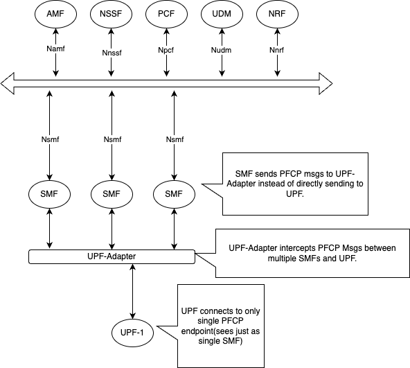

<!--
SPDX-FileCopyrightText: 2024 Intel Corporation
SPDX-FileCopyrightText: 2024 Canonical Ltd.
SPDX-License-Identifier: Apache-2.0
-->

# upfadapter

`upfadapter` is required to scale the SMF's in SD-Core. The SMF sends custom PFCP messages to `upfadapter`, which intercepts and modifies specific fields before sending the messages to the UPF.

## Reach out to us through

1. #sdcore-dev channel in [Aether Community Slack](https://aether5g-project.slack.com)
